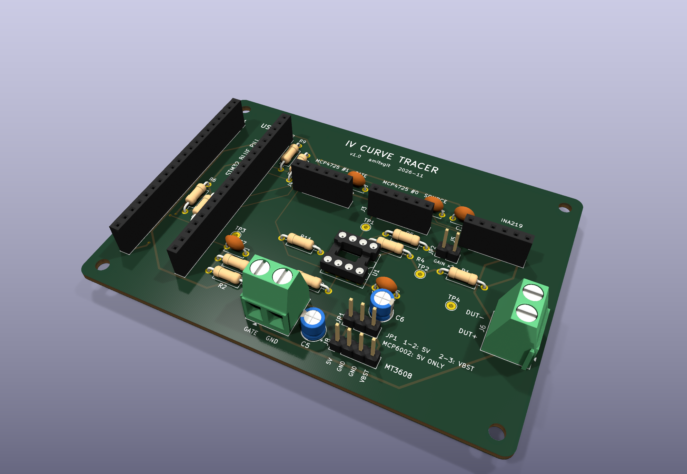
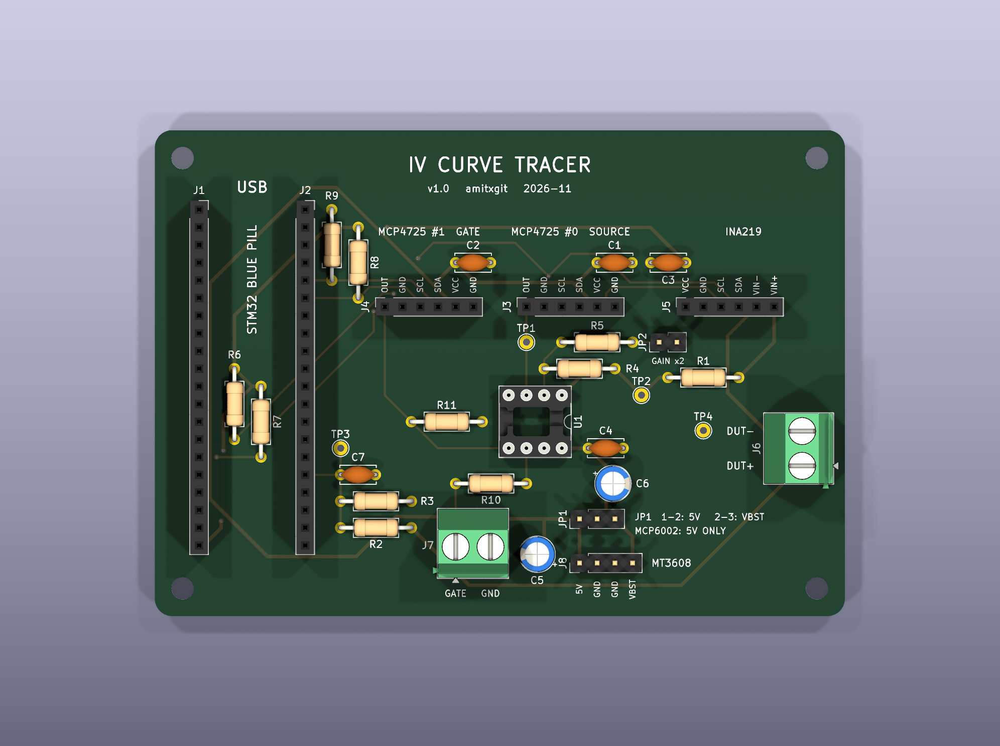
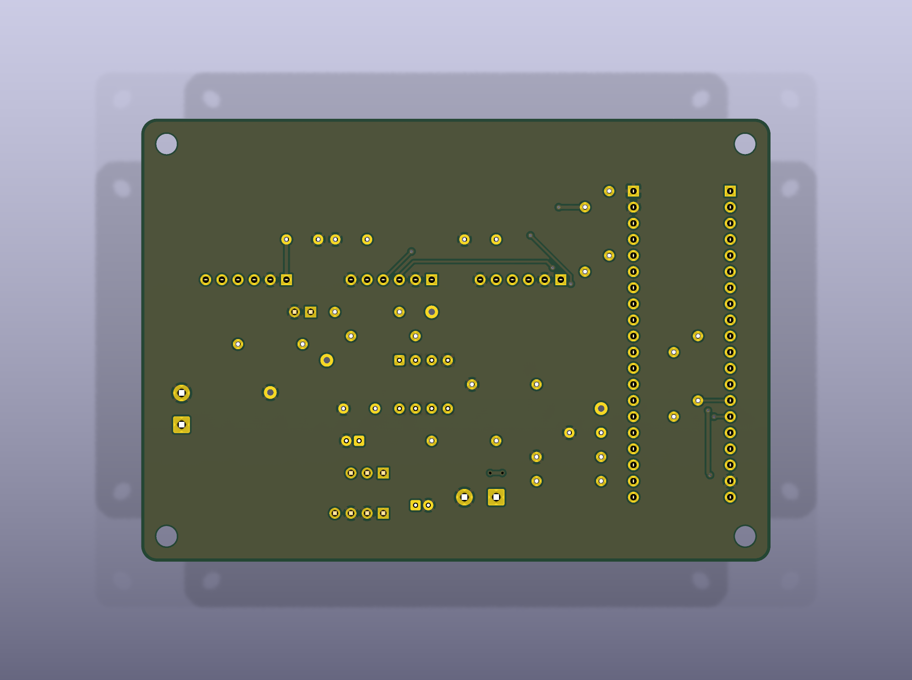

# USB-Controlled SCPI I-V Curve Tracer

A self-built, PCB-based bench instrument that sweeps voltage across a
device under test (DUT) — diode, BJT, MOSFET, resistor — and measures
the resulting current, streaming SCPI-style commands over USB-CDC to a
Python client that plots and logs the I-V curve.

Think of it as a single-channel, low-cost analogue of a lab SMU
(Keithley 2635B / Keysight B2985B class instrument), built from scratch
to demonstrate instrumentation design: precision analogue signal
chain, embedded firmware, a real command protocol, and a PC-side
automation client.

## Repository layout

```
iv-curve-tracer/
├── hardware/           KiCad project + schematic/connection notes
├── firmware/           STM32F103 firmware (SCPI parser, drivers, sweep engine)
├── software/           Python PC client (iv_tracer package)
├── docs/               BOM, pin mapping, SCPI reference, PCB layout rules, validation plan
├── LICENSE-HARDWARE    CERN-OHL-P-2.0 (hardware design files)
└── LICENSE-SOFTWARE    MIT (firmware + PC client)
```

## Hardware



The carrier board takes a Blue Pill, two MCP4725 DAC breakouts and an
INA219 breakout on sockets, and adds the op-amp buffer / gain stage,
the current-limit resistor, the Kelvin V-sense divider and the DUT
terminal. KiCad project: `hardware/kicad/iv-curve-tracer-pcb/`.
Schematic PDF: `docs/schematic.pdf`. Build notes, jumper settings and
module pin order: `hardware/schematic_notes.md`.

| Top | Bottom |
|-----|--------|
|  |  |

## Quick start (once hardware is built)

```bash
cd software
pip install -r requirements.txt
python -m iv_tracer.cli --port /dev/ttyACM0 --start 0 --stop 5 --step 0.05 --dwell 10 --plot --save diode_sweep.csv
```

## Project status

- [x] Schematic captured in KiCad (ERC clean)
- [x] PCB laid out, 2-layer carrier board rev 1.0 (DRC clean)
- [ ] PCB fabricated (JLCPCB, 2-layer)
- [ ] Firmware: DAC sweep + USB-CDC bring-up (drivers + SCPI parser + sweep engine written; needs on-board bring-up)
- [x] Firmware: SCPI parser + sweep engine (with error queue + *RST state reset)
- [x] Python client: sweep/plot/CSV export
- [x] Hardware-free simulator + pytest suite (run the full pipeline before the board exists)
- [ ] Validation: known diode + known resistor vs datasheet/multimeter (on real hardware)
- [ ] README + resume bullets + GitHub push

## Why this exists

Built as a standalone portfolio project for semiconductor test /
applications engineering roles — demonstrates the same instrumentation
skill set (PyVISA/SCPI automation, precision analogue measurement)
used in real lab work, but from the instrument-design side rather than
the instrument-user side.

See `docs/validation_plan.md` for how the tracer is validated against
known references, and `docs/scpi_command_reference.md` for the full
command set.
