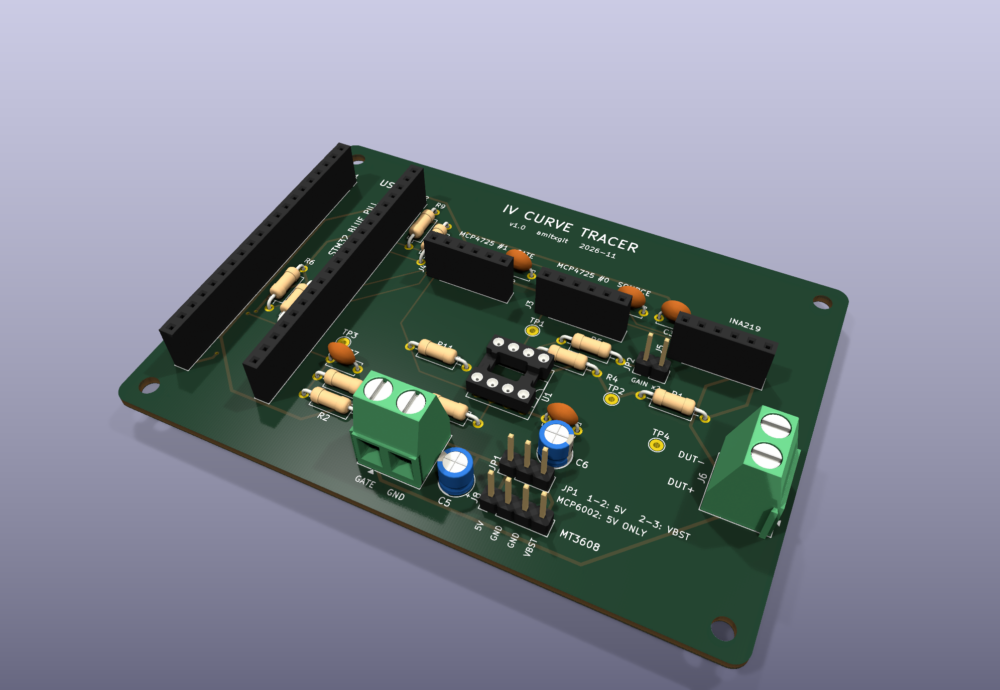

# Schematic & Board Notes (rev 1.0)

The KiCad 10 project lives in `hardware/kicad/iv-curve-tracer-pcb/`:

| File | What it is |
|------|------------|
| `iv-curve-tracer-pcb.kicad_pro` | Project, net classes and design rules |
| `iv-curve-tracer-pcb.kicad_sch` | Schematic (single A4 sheet) |
| `iv-curve-tracer-pcb.kicad_pcb` | 2-layer board, 99.06 x 69.85 mm |

A PDF of the schematic is in `docs/schematic.pdf` and board renders are
in `docs/images/`. See `docs/pin_mapping.md` for the net list rationale
and `docs/BOM.csv` for part numbers (same reference designators).



## Block diagram

```
   +-----------+ I2C1  +------------+ DAC0_OUT +--------------+ SRC_BUF +------+ SRC_LIM +---------+ DUT+
   | Blue Pill |------>| MCP4725 #0 |--------->| U1A buffer / |-------->|  R1  |-------->| INA219  |------+--> J6 DUT+ --> DUT --> J6 DUT- (GND)
   | (J1 + J2) |       |    (J3)    |   TP1    | x2 gain      |   TP2   | 150R |         |  (J5)   |      |
   |           |       +------------+          +--------------+         +------+         +---------+      |
   |           | I2C1 (shared) --------------------------------------------------------------^            |
   |           |                                                                                          |
   |  PA0 ADC  |<---- VSENSE (TP3) ---- R2 30k / R3 10k + C7 <---- Kelvin tap taken at the J6 pad --------+
   |           |
   |           | I2C2  +------------+ DAC1_OUT +--------------+ GATE_BUF +------+ GATE
   |           |------>| MCP4725 #1 |--------->| U1B follower |--------->| R10  |------> J7 (v2 gate/base drive)
   +-----------+       |    (J4)    |          +--------------+          |  1k  |
        |              +------------+                                    +------+
     USB-CDC
        v
   PC (Python client, SCPI over serial)
```

## What is on the sheet

1. **MCU** -- two 1x20 sockets (J1, J2) that the Blue Pill plugs into.
   Pin 1 of both sockets is at the USB-connector end. Only PB6/PB7
   (I2C1), PB10/PB11 (I2C2), PA0 (ADC), 5V, 3V3 and GND are used; every
   other pin carries a no-connect flag.
2. **Breakout sockets** -- J3 (MCP4725 #0, source), J4 (MCP4725 #1,
   gate drive, v2) and J5 (INA219), each a 1x06 socket with its own
   100 nF decoupling capacitor (C1-C3).
3. **Source buffer / gain stage** -- U1A. JP2 open gives a unity-gain
   buffer (0-5 V); JP2 closed puts R5 to ground for a gain of 2
   (0-10 V). R1 (150R) follows the op-amp output, then the INA219.
4. **Gate / base drive buffer** -- U1B as a follower on the second DAC,
   out through R10 to J7. R11 holds the input low when the second DAC
   is not fitted, so the spare op-amp half never floats.
5. **Op-amp supply** -- JP1 picks 5 V or the MT3608 boost rail
   (VBOOST, wired in through J8). C4 + C6 decouple the op-amp rail,
   C5 the 5 V rail.
6. **DUT terminal + Kelvin V-sense** -- J6, with the 30k/10k divider
   (R2/R3) and a 100 nF filter (C7) feeding PA0.
7. **I2C pull-ups** -- R6-R9 to 3V3. Optional: most breakouts already
   have pull-ups, so only fit these on a bus that needs them.

## Module pin order assumed by the sockets

Check these against the silkscreen on the breakouts you actually have
before soldering the sockets -- clone boards are not all the same.
Pin 1 is the square pad; the names are also printed on the board.

| Socket | Pin 1 | 2 | 3 | 4 | 5 | 6 |
|--------|-------|---|---|---|---|---|
| J3 / J4 (MCP4725) | OUT | GND | SCL | SDA | VCC | GND |
| J5 (INA219) | VCC | GND | SCL | SDA | VIN- | VIN+ |

The MT3608 module is not mounted on the board. Wire it to J8:
pin 1 = 5 V to VIN+, pin 2 = GND to VIN-, pin 3 = GND from VOUT-,
pin 4 = VBOOST from VOUT+. Set its output to about 12 V *before*
connecting it.

## Jumpers

| Jumper | Position | Effect |
|--------|----------|--------|
| JP1 | 1-2 | Op-amp runs from 5 V (use this with the MCP6002) |
| JP1 | 2-3 | Op-amp runs from VBOOST (~12 V) |
| JP2 | open | Gain 1, 0-5 V output range |
| JP2 | closed | Gain 2, 0-10 V output range (needs JP1 2-3) |

**The MCP6002 is rated for 6 V maximum.** Never put JP1 on 2-3 with an
MCP6002 in the socket. For the 0-10 V range fit a pin-compatible
op-amp rated for the boost rail (LM358 works: its output reaches about
V+ minus 1.5 V, so 12 V in gives the full 10 V).

## Test points

| TP | Net | Use |
|----|-----|-----|
| TP1 | DAC0_OUT | Raw DAC output, before the buffer |
| TP2 | SRC_BUF | Op-amp output, before R1 |
| TP3 | VSENSE | Divider midpoint, what PA0 sees (Vdut / 4) |
| TP4 | GND | Ground reference for the probe |

## Checks run on this revision

- ERC: 0 errors, 0 warnings.
- DRC with schematic parity: 0 violations, 0 unconnected pads,
  0 footprint errors.
- Design rules: 0.2 mm clearance, 0.3 mm signal tracks, 0.5 mm tracks on
  the supply rails and on the source path (SRC_BUF, SRC_LIM, DUT+),
  0.8/0.4 mm vias, 0.5 mm copper-to-edge. Comfortably inside JLCPCB's
  standard 2-layer capability.

## Before ordering

1. Breadboard the full analogue chain first (DAC -> buffer -> R_limit
   -> INA219 -> resistor DUT -> GND, with the divider tapped in) and get
   a sweep working over USB-CDC.
2. Only commit to PCB fab once the breadboard sweep produces a sane
   V-I line for a known resistor.
3. Hold the real modules against the socket positions (a 1:1 print of
   the board works) and confirm the pin order table above.
